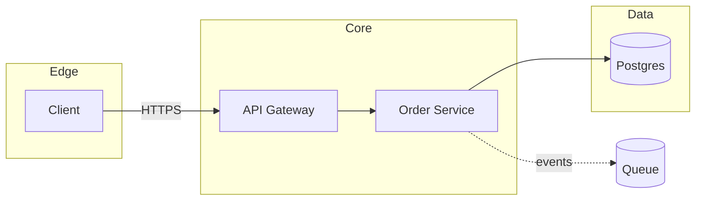

# Architecture

**Best for:** system overviews, service maps, integration topology, infra layout, request/data flow across components.

Read [`svg-grammar.md`](svg-grammar.md) for connectors and zones; this file is layout only.

## Layout

- **Group by tier or trust boundary** and hold one flow direction: frontend → backend → data (left→right), or public → private (top→down). Pick one.
- Use **zones** (svg-grammar.md) for 2+ nodes in the same tier. Max 3 zones; a dashed `rule-solid` border marks a trust/VPC boundary, a quiet `paper-2` fill marks a logical tier.
- **Accent** the single most important node — the primary integration point, the system of record, or the entry point — and at most one more.
- Draw arrows before boxes. API/network edges use `link` color + `arrow-link`; the one or two focal flows use `accent`.

## Node conventions

- Name = capability, not product, unless the product *is* the point (`Order Service`, not `svc-order-v3`). Put the technical detail (`:443 · gRPC`, `Postgres 15`) in the mono sublabel when audience is `mixed`/`technical`.
- Collapse replicas: `Worker ×6`, not six boxes.
- Data stores get a distinct silhouette if you want — a rect with a subtle top arc — but a labeled rect with a `DATASTORE` eyebrow reads just as clearly; don't over-skeuomorph.

## Anti-patterns

- Every box accented ("all important") — hierarchy collapses to noise.
- Bidirectional arrows where one direction is obvious from context.
- A legend floating inside the diagram — put it in the bottom strip or the caption.
- More than ~9 unzoned nodes — zone it (faithful) or split into overview + per-zone detail.

## Mermaid

````text

````

## Reference example

`../assets/example-architecture.html` — a rendered, self-contained example built to this grammar. Open it in a browser or screenshot it to PNG; use it as the visual target, not a template to copy verbatim.

## Motion (optional)

Set the `flow` dial to send an accent comet along the focal request path and marching ants along an async/events edge. See [`animation.md`](animation.md) — animate only the focal edge(s), guard with `prefers-reduced-motion`, and keep the static frame complete.
