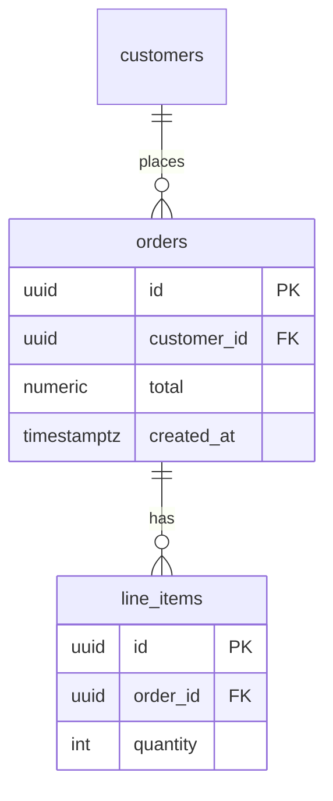

# Database schema

**Best for:** a *physical* database — actual tables, their columns with types, primary/foreign/unique keys, and the joins between them. For a conceptual entity model without column-level detail, use [`er-model.md`](er-model.md) instead.

Read [`svg-grammar.md`](svg-grammar.md) for connectors.

## Table block

Each table is a rounded rect built as a small stack:

- **Header band:** table name in `node` weight on a `paper-2` fill, with a `TABLE` eyebrow.
- **Column rows:** one per line, mono. Each row: `name` · `type`, with a key chip on the left gutter:
  - `PK` (accent-tinted chip) — primary key.
  - `FK` — foreign key; the row is the join source.
  - `UK` — unique; `NN` — not null (optional, only if it carries meaning).
- Keep a hairline `rule` between the header and the columns; don't rule every row (too busy) — rely on line height.

```svg
<!-- header -->
<rect x="80" y="80" width="220" height="28" rx="8" fill="var(--paper-2)" stroke="var(--rule-solid)"/>
<text x="92" y="98" font-family="Inter" font-weight="600" font-size="13" fill="var(--ink)">orders</text>
<!-- body with columns as <text> rows; PK row chip in accent-tint -->
```

## Relationships

- Draw a connector from the **FK column row** of the child table to the **PK row** of the parent table — anchor on the specific rows, not the table corners, so the join is unambiguous.
- Use crow's-foot ends (see er-model.md): `PK` side = one (tick), `FK` side = many (crow's foot). A nullable FK gets an open circle.
- Route orthogonally; hop the less-important crossing (svg-grammar.md). Group tables by bounded context/schema with a zone if there are many.
- **Accent** the central/fact table (the one most foreign keys point at).

## Anti-patterns

- Connectors landing on table edges instead of the specific FK/PK rows — the reader can't tell which columns join.
- Dumping every column when 30 columns hide the 4 that matter — for a wide table, show keys + the columns the diagram is about and note `… +22 columns`.
- Mixing conceptual and physical — if there are no types and no keys, it's an ER model; if there are, commit to real column types (`uuid`, `varchar(255)`, `timestamptz`).

## Mermaid

````text

````

## Reference example

`../assets/example-db-schema.html` — a rendered, self-contained example built to this grammar. Open it in a browser or screenshot it to PNG; use it as the visual target, not a template to copy verbatim.
