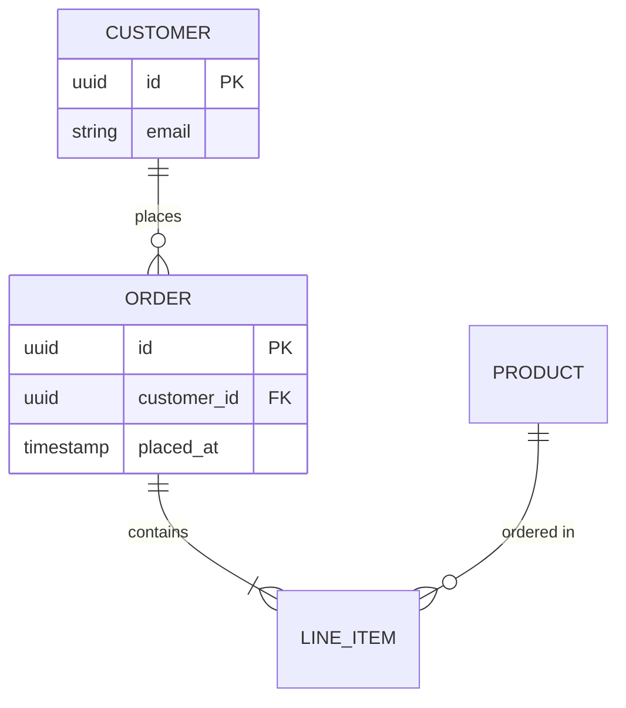

# ER / data model

**Best for:** a conceptual or logical data model — entities, their key attributes, and the relationships (cardinality) between them. For physical tables with exact column types and keys, use [`db-schema.md`](db-schema.md) instead.

Read [`svg-grammar.md`](svg-grammar.md) for connectors.

## Layout

- **Entities** are rounded rects with a header band (entity name, `node` weight) and a short list of its defining attributes below — mono, one per line. Keep to the attributes that *identify or relate* the entity; a conceptual model is not a column dump.
- Mark the identifier with a small `PK` chip or bold; a reference attribute with `FK`.
- **Relationships** are lines between entities, labeled with the verb reading one way (`places`, `contains`, `belongs to`).
- **Cardinality** sits at each line end using crow's-foot notation:
  - `one` → a single perpendicular tick.
  - `many` → the three-pronged crow's foot.
  - `zero-or` → an open circle; `one-and-only` → a tick near the entity.
  - So "one customer places many orders" = tick at Customer, crow's foot at Order.
- Arrange related entities adjacent; the most-connected entity (often the hub) goes center. **Accent** that hub or the entity the model is really about.

## Anti-patterns

- Listing every column — that's a physical schema; keep conceptual entities lean.
- Ambiguous cardinality — every relationship end states one/many/optional; "a line with no ticks" hides the rule.
- Many-to-many drawn as a bare line — show the join/associative entity if it carries attributes.

## Mermaid

````text

````

## Reference example

`../assets/example-er-model.html` — a rendered, self-contained example built to this grammar. Open it in a browser or screenshot it to PNG; use it as the visual target, not a template to copy verbatim.
