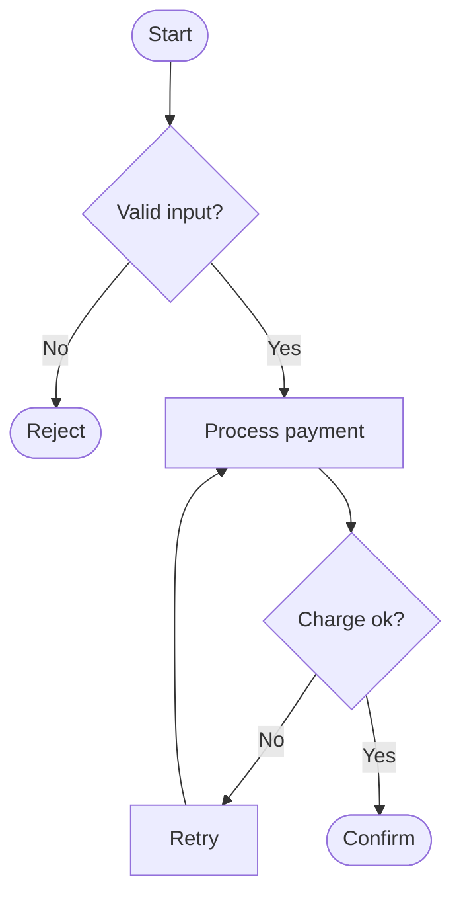

# Flowchart

**Best for:** decision logic, branching processes, algorithms, approval flows — anything where the *path* through choices is the message.

Read [`svg-grammar.md`](svg-grammar.md) for connectors.

## Shapes (keep the vocabulary small)

| Meaning | Shape |
|---|---|
| Start / end | stadium (rect with fully rounded ends, `rx = height/2`) |
| Process / action | rounded rect (`rx=8`) |
| Decision | diamond (rotated square) — the only non-rect shape you need |
| Input / output | parallelogram (optional; a labeled rect works too) |

Don't invent more shapes. Four is enough; more makes the reader learn a key.

## Layout

- **Top→down** is the default; the main "happy path" runs straight down the center spine.
- A decision diamond has **labeled exits** — `Yes`/`No`, `valid`/`invalid` — on the edges leaving it. Every exit must be labeled; an unlabeled branch is a bug.
- Keep the **success path vertical and unbroken**; push exception/No branches out to the side and let them rejoin or terminate. Use the `accent` on the one outcome that matters most (the success terminal, or the critical decision).
- Merge points: multiple arrows into one node is fine; don't draw a separate merge diamond unless the merge itself is a decision.
- Failure/error exits use a dashed line or the `danger` color — sparingly.

## Anti-patterns

- Diamonds with three+ exits where two would do — collapse compound conditions into one clear question, or split into two diamonds.
- Lines crossing the main spine un-hopped — re-flow so the happy path stays clean.
- A flowchart that's really a sequence (messages between actors) — use the sequence type.

## Mermaid

````text

````

## Reference example

`../assets/example-flowchart.html` — a rendered, self-contained example built to this grammar. Open it in a browser or screenshot it to PNG; use it as the visual target, not a template to copy verbatim.

## Motion (optional)

Draw-on the happy-path spine or send a comet down it; pulse the focal terminal. Keep exception branches static. See [`animation.md`](animation.md) — animate only the focal edge(s), guard with `prefers-reduced-motion`, and keep the static frame complete.
