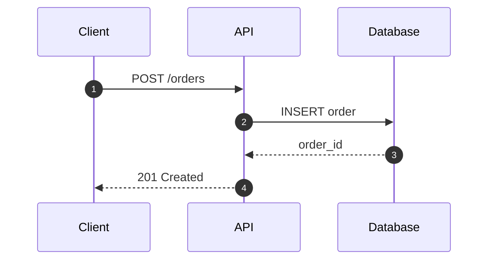

# Output & export

How the five dials (SKILL.md §4) become a file, plus how to export PNG/SVG and when/how to emit Mermaid instead.

---

## Size presets

The preset sets the SVG `viewBox`. Every value is divisible by 4, so the grid rule holds.

| Preset | viewBox | Aspect | Type ramp | Use |
|---|---|---|---|---|
| `doc` (default) | `0 0 960 600` | 8:5 | standard | Body-width in a post or README |
| `wide` | `0 0 1280 720` | 16:9 | standard | Full-width docs / wiki |
| `slide` | `0 0 1280 720` | 16:9 | presentation | Projected deck slide |
| `social` | `0 0 1200 630` | 1.9:1 | presentation | Link / OG card |
| `square` | `0 0 1080 1080` | 1:1 | presentation | Feed post, carousel |
| `fit` | from content | any | standard | Vector hand-off, no fixed frame |

**Type ramp.** `standard`: title 28 / node 13 / sublabel 10 / edge 9. `presentation`: title 40 / node 16 / sublabel 12 / edge 11, min box height 64, min gap 40. If a `slide` layout won't fit at the presentation ramp, that means the **detail** dial is too high — drop a level rather than shrinking the type.

**Deriving `fit`.** Round the content bounding box up to the next multiple of 4, then add fixed chrome: 40px margin each side, plus 56px at the bottom if there's a legend strip. Content never touches the viewBox edge.

---

## Detail ladder

When the source has more than the level allows, cut in this order and stop as soon as you're under budget:

1. Decorative elements — notes, title blocks, the source's own legend.
2. Exact duplicates — N identical workers become one node labeled `Worker ×N`.
3. Leaf clusters — a container whose children are all leaves collapses to the container.
4. Degree-1 sinks that don't change the story — a log bucket, an archive tier.
5. Cross-cutting infra — logging, metrics, secrets, CI (drop at `simplified`; keep ≤1 at `balanced` only if the diagram is about it).
6. Still over budget? **Split** into an overview (zones as nodes) plus one detail diagram per zone. Splitting beats shrinking.

Above 9 nodes at `faithful`, **zoning is mandatory** (see svg-grammar.md) — an unzoned 20-node canvas is a wiring diagram, not a schematic.

---

## Exporting to PNG / SVG

The HTML is always the source of truth. Never hand-author a standalone `.svg` or draw to PNG directly — produce both *from* the rendered HTML so they match the taste gate.

**PNG** — render the HTML in a headless browser and screenshot the `.wrap` element (or the `<svg>`) at a device scale factor for crispness:

- `@2` for screens, slides, social, docs.
- `@3` for print.

If Playwright is available in the environment, use it: navigate to the local `file://` path, wait for fonts (`document.fonts.ready`), and screenshot the element. Otherwise tell the user the one command they can run, e.g. a headless Chrome `--screenshot` invocation, and leave the HTML in place.

**SVG** — extract the `<svg>` node from the HTML and write it next to the source. Note that `var(--token)` custom properties must be resolved to concrete hex values for standalone SVG (offline tools won't evaluate the `:root` CSS), and web fonts will substitute unless you convert text to paths. For faithful vector hand-off, prefer `fit` size and inline the computed colors.

---

## Mermaid output

Choose `mermaid` when the user wants to paste into GitHub, GitLab, Notion, Obsidian, or a docs site that renders Mermaid — they trade the editorial styling and exact layout for a single portable code block. Print the fenced block directly in the reply.

The design system does not apply to Mermaid (the renderer owns layout and theme), but you can nudge theme with a `%%{init}%%` directive. Keep the same **content discipline** — same node count, same one-idea-per-node rule, same primary direction.

Type → Mermaid mapping:

| Type | Mermaid kind | Notes |
|---|---|---|
| Architecture | `flowchart LR` | subgraphs for zones; `-->` solid, `-.->` dashed |
| Flowchart | `flowchart TD` | `{ }` decision, `[ ]` process, `([ ])` start/end |
| Sequence | `sequenceDiagram` | `->>` call, `-->>` return, `alt`/`opt`/`loop` blocks |
| State machine | `stateDiagram-v2` | `[*]` start/end; `state X { }` for composite |
| ER / data model | `erDiagram` | `A \|\|--o{ B : has`; attributes with PK/FK |
| Timeline | `timeline` | `section` per era; `title` on top |
| Tree | `flowchart TD` or `mindmap` | `mindmap` for a single-root idea tree |
| Database schema | `erDiagram` | columns as attributes with type + `PK`/`FK`/`UK` keys |

Example (sequence):

````text

````

Optional light/dark nudge:

```text
%%{init: {'theme':'neutral'}}%%
```

Keep the block self-contained — no external config — so it renders wherever Mermaid is supported.
