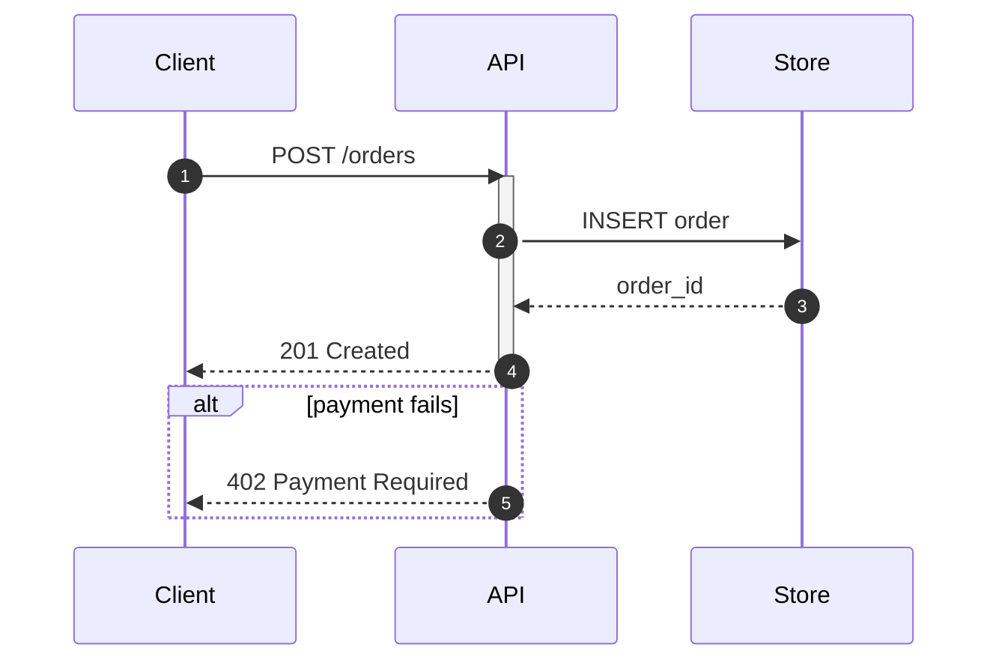

# Sequence

**Best for:** time-ordered messages between participants — API call chains, protocol handshakes, request/response traces, event flows across services.

Read [`svg-grammar.md`](svg-grammar.md) for arrowheads.

## Layout

- **Participants** are columns across the top, each a labeled box (`node` style). Order them left→right in the order they first act — usually `Client · API · Service · Store`.
- From each participant a **lifeline** drops straight down as a thin `rule` vertical line.
- **Time flows down.** Messages are horizontal arrows between lifelines, stacked top→down in chronological order. Never reorder for layout; order *is* the meaning.
- **Message types:**
  - Synchronous call → solid arrow (`arrow`), filled head.
  - Return / response → dashed arrow (`stroke-dasharray="4,3"`), same direction back.
  - Async / fire-and-forget → solid arrow, open head (or a `link` color).
- **Activation bars** (optional): a thin filled `paper-2` rect over the lifeline while a participant is processing. Use only if "who is busy when" matters; otherwise omit — they add ink.
- Label every arrow with the message: `POST /orders`, `order_id`, `202 Accepted`. Mono, on a `paper` mask over the lifeline it crosses.
- **Accent** the one message that is the point of the diagram (the critical call or the failure).

## Fragments

For conditional or repeated stretches, draw a labeled frame around the messages: a `rule`-bordered rect with a small tab at top-left reading `alt`, `opt`, `loop`, or `par`. Keep to one or two frames; nested frames get unreadable fast.

## Anti-patterns

- Arrows that skip a lifeline diagonally — they're still horizontal between two columns; a message from Client to Store that "goes through" API is two messages, not one.
- Re-ordering messages to avoid a crossing — time order is sacred; if two messages truly cross, the participants are mis-ordered.
- More than ~6 participants — split by subsystem.

## Mermaid

````text

````

## Reference example

`../assets/example-sequence.html` — a rendered, self-contained example built to this grammar. Open it in a browser or screenshot it to PNG; use it as the visual target, not a template to copy verbatim.

## Motion (optional)

Stagger a comet per message top-to-bottom so the pulse mirrors time order; the declined/alt branch stays static. See [`animation.md`](animation.md) — animate only the focal edge(s), guard with `prefers-reduced-motion`, and keep the static frame complete.
