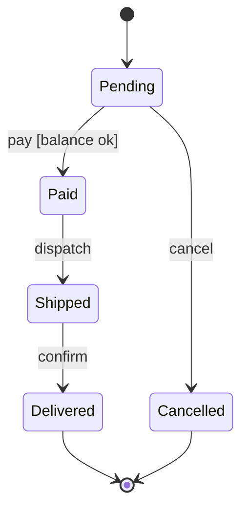

# State machine

**Best for:** the lifecycle of one thing — an order, a connection, a job, a UI component — showing its states and what events move it between them.

Read [`svg-grammar.md`](svg-grammar.md) for connectors.

## Layout

- **States** are rounded rects (`rx=8`), named as adjectives/nouns describing a condition the thing *is in*: `Pending`, `Shipped`, `Cancelled` — not actions.
- **Initial state:** a small filled `ink` dot with an arrow into the first state. **Terminal state:** a filled dot inside a ring (or a double border) — reached by states that end the lifecycle.
- **Transitions** are arrows labeled with the **event** that triggers them, optionally `event [guard] / action`: `submit`, `pay [balance ≥ total] / charge`. Mono edge labels on a `paper` mask.
- Lay states left→right or top→down following the **dominant happy path**; loop-backs and error transitions curve back with orthogonal elbows. A self-transition is a small loop off the top of the state.
- **Accent** the most important state (the goal state, or the one the diagram is warning about). Error/failure transitions can use `danger`, sparingly.
- **Composite states:** a larger rounded rect containing sub-states, labeled at top-left — use only when a group of states shares an entry/exit.

## Anti-patterns

- States named as verbs (`Submitting`) when you mean a condition (`Pending`) — pick one convention; condition-nouns read better.
- Unlabeled transitions — every arrow names its event; an unlabeled transition hides the logic.
- A transition from every state to `Cancelled` drawn individually — if *any* state can cancel, say so in the caption or use one composite boundary, don't draw a web.
- This isn't a flowchart: nodes are *states the thing rests in*, not processing steps.

## Mermaid

````text

````

## Reference example

`../assets/example-state-machine.html` — a rendered, self-contained example built to this grammar. Open it in a browser or screenshot it to PNG; use it as the visual target, not a template to copy verbatim.

## Motion (optional)

Send a comet along the happy-path transitions, or give the goal state a slow pulse. Error transitions stay static. See [`animation.md`](animation.md) — animate only the focal edge(s), guard with `prefers-reduced-motion`, and keep the static frame complete.
