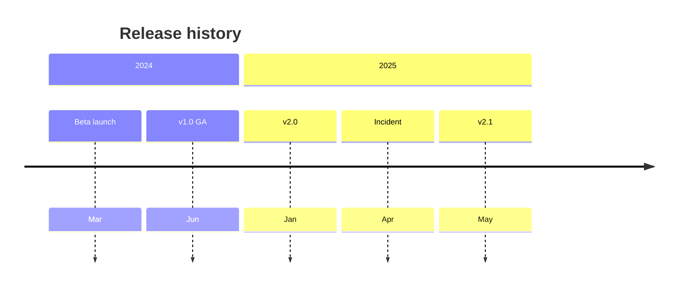

# Timeline

**Best for:** events positioned along time — project milestones, release history, incident chronology, a roadmap. If you're showing tasks with *durations and dependencies*, that's a Gantt (a timeline shows points; a Gantt shows bars).

Read [`svg-grammar.md`](svg-grammar.md) for labels.

## Layout

- **One axis = time.** Horizontal for few events across a broad span (roadmap, history); vertical for many events or long labels (changelog, incident log).
- Draw the axis as a single `rule-solid` line. Place a **tick + label** at each event; alternate labels above/below the axis (horizontal) or left/right (vertical) to avoid collision when events are dense.
- **Event marker:** a small filled dot on the axis. Title in `node` weight, date in mono `sublabel` beneath.
- **Segment the span** into eras with light `eyebrow` labels (`2023`, `PHASE 1`) along the axis when it helps the reader locate events.
- Keep time **monotonic and roughly to scale** — if Jan and Dec sit the same distance apart as Dec and next-Jan, the reader is misled. If events cluster, break the axis with a visible gap mark rather than squashing.
- **Accent** the single most important event — the launch, the incident, the decision — and at most one more (e.g. "today").

## Anti-patterns

- Evenly spacing events that are not evenly spaced in time (unless you explicitly label it as ordinal, not scaled).
- A timeline that's really a sequence of steps with no real dates — use a process flow or numbered list.
- Cramming 20 events on one axis — group into eras, or split.

## Mermaid

````text

````

## Reference example

`../assets/example-timeline.html` — a rendered, self-contained example built to this grammar. Open it in a browser or screenshot it to PNG; use it as the visual target, not a template to copy verbatim.

## Motion (optional)

Reveal events left-to-right in time order (draw-on the axis, then fade each card in). Usually better left static. See [`animation.md`](animation.md) — animate only the focal edge(s), guard with `prefers-reduced-motion`, and keep the static frame complete.
