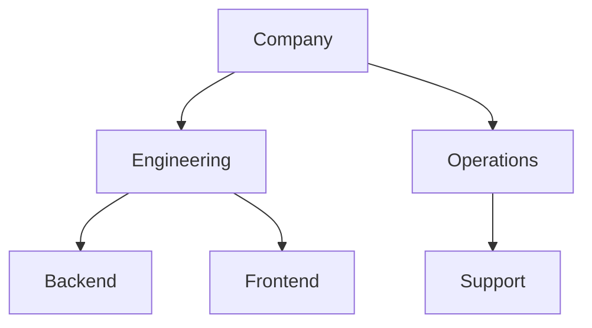
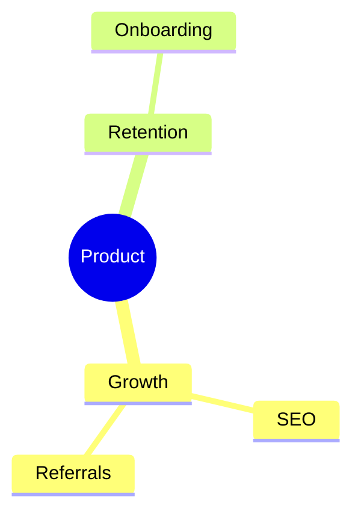

# Tree

**Best for:** strict parent → children hierarchies — org charts, file/folder structures, taxonomies, decision trees, component trees, decomposition. One root, each node has exactly one parent.

Read [`svg-grammar.md`](svg-grammar.md) for connectors.

## Layout

- **Root at top, children fan down** (top→down is clearest for most trees); use left→right for deep, narrow trees (file systems, mind-map-style breakdowns) where vertical space runs out.
- Connect parent to child with orthogonal elbows that share a **common trunk**: one vertical line drops from the parent, then short horizontal stubs fan to each child's top. This "comb" routing reads far cleaner than N independent elbows.
- **Balance siblings** at the same depth on one horizontal band; keep consistent vertical gaps between levels so depth is readable at a glance.
- Leaf nodes can be lighter (smaller box, `soft` text) to let the branching structure dominate.
- **Accent** the root or the one branch/leaf the diagram is about.
- Deep trees: collapse uninteresting subtrees to a single node labeled `… (12 more)` and note it in the caption rather than drawing everything.

## Anti-patterns

- A node with two parents — that's a graph/DAG, not a tree; use an architecture or dependency layout, or introduce a shared node explicitly.
- Crossing sibling lines — siblings never cross in a real tree; if they do, the order is wrong.
- Inconsistent level spacing that makes a shallow tree look deep.

## Mermaid

````text

````

For a single-root *idea* breakdown (brainstorm, topic map), `mindmap` reads better than `flowchart`:

````text

````

## Reference example

`../assets/example-tree.html` — a rendered, self-contained example built to this grammar. Open it in a browser or screenshot it to PNG; use it as the visual target, not a template to copy verbatim.
